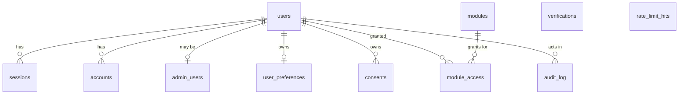

# Database (Cloudflare D1)

Schema lives in `frontend/db/schema.ts` (Drizzle). Migrations are generated SQL in `frontend/db/migrations/`. D1 settings are in `frontend/wrangler.jsonc` (the same file the Worker uses).

No launch feature uses D1 yet. `0000_init` is empty; `0001` creates the tables below (GNR-63), so they exist but nothing reads them until auth lands.

## Workflow (run from `frontend/`)
1. Edit `db/schema.ts`.
2. `npm run db:generate`, then read the new SQL in `db/migrations/`.
3. `npm run db:migrate:local`, then test. State lives in `.wrangler/` (git-ignored).
4. Commit.
5. Only then `db:migrate:preview` (dev database) and `db:migrate:remote` (prod). Both ask you to type the database name, and refuse to run without a terminal.

| Script | What it does |
|---|---|
| `db:generate` | drizzle-kit writes a migration from the schema diff |
| `db:migrate:local` | applies migrations to the local D1 |
| `db:migrate:preview` | applies to the **remote dev** database (confirmation) |
| `db:migrate:remote` | applies to the **remote prod** database (confirmation) |
| `db:seed:local` | runs `db/seed.sql` locally |
| `db:query:local -- "SQL"` | runs one statement locally |

`db:studio` from the ticket is not included yet; it needs a table to be useful.

## Databases
Two: `gnrdigital-prod` and `gnrdigital-dev` (the `preview` environment in `wrangler.jsonc`, so unmerged code never touches real data). Check the spelling, because a typo stays forever to match the dashboard.

Creating them is a remote action done by the owner, once:
```bash
npx wrangler d1 create gnrdigital-prod
npx wrangler d1 create gnrdigital-dev
```
Then put the printed ids into `wrangler.jsonc` (top-level `database_id` = prod, `env.preview` `database_id` = dev). Never create them against an account holding other projects' databases without checking the name list first (`npx wrangler d1 list`).

Rules: no SQL built from strings in app code; use Drizzle.

## Schema (`frontend/db/schema.ts`)



- `users`, `sessions`, `accounts`, `verifications`: the Better Auth core tables (its default field names, plus `username`, `first_name`, `last_name`).
- `admin_users`: admin role, deliberately separate from `users`, so a user row can never grant itself admin.
- `modules` / `module_access`: runtime on/off switches and per-person grants.
- `rate_limit_hits`: counters keyed by route + salted IP hash and minute (GNR-133). No raw IPs.
- `audit_log`: append-only trail of admin reads and writes.
- `user_preferences`, `consents`: user-owned data.

**No row-level security on D1.** Every query on user-owned rows filters by the session user id (see `functions/_lib/userData.ts` for the pattern), admin reads go through audited admin endpoints, and `functions/_lib/schema.test.js` checks ownership, cascades and uniqueness against the real migrations.
